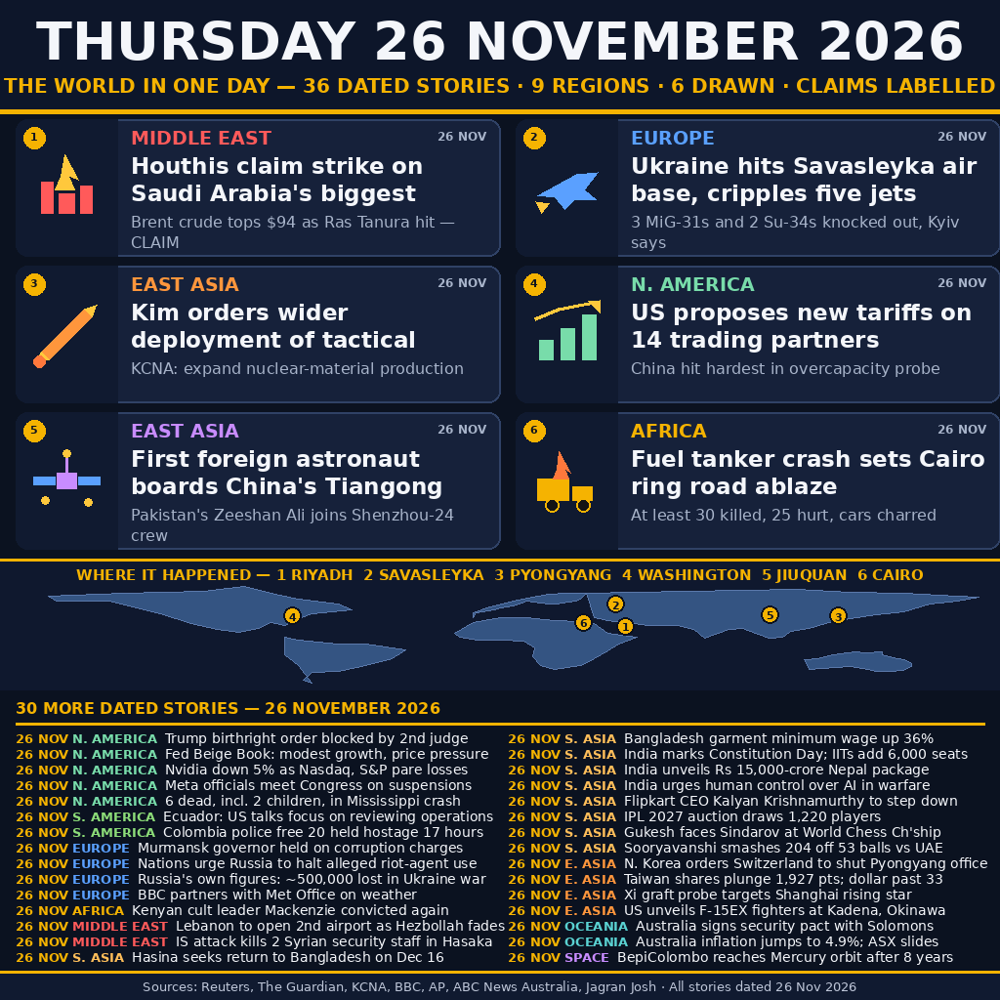

# Thursday 26 November 2026: the world in one day — 36 dated stories, 9 regions, 6 drawn, claims labelled

[](https://make.fun/bounty/news-image-20261126?utm_source=github&utm_medium=readme&utm_campaign=news-image-20261126)
[](https://make.fun/bounty/news-image-20261126/leaderboard?utm_source=github&utm_medium=readme&utm_campaign=news-image-20261126)
[](https://make.fun/bounty/news-image-20261126?utm_source=github&utm_medium=readme&utm_campaign=news-image-20261126)

Sum up 26 November 2026's world news in one image: a 1024×1024 newspaper-style infographic rendered with Python (PIL) from real headlines researched that day — 36 dated stories across 9 regions, with 6 illustrated hero cards, a pinned world map, and claims labelled as claims.

Hero stories: the Houthi claim of a strike on Saudi Arabia's Ras Tanura refinery as Brent tops $94; Ukraine's strike on Savasleyka air base crippling five jets; Kim Jong Un ordering wider deployment of tactical nuclear weapons; the US proposing new tariffs on 14 trading partners; the first foreign astronaut boarding China's Tiangong station; and the fuel-tanker fire on Cairo's ring road that killed at least 30.



## Run it

```sh
python3 main.py
```

`main.py` renders the image with `gen_image.py` (Pillow + bundled DejaVu fonts, no network, fully deterministic) and writes it to `$MAKEFUN_OUTPUT_DIR/entry.png` (default `/output/entry.png`). If Pillow is unavailable it falls back to the pre-rendered `news.png` shipped in this repo.

## Sources

Headlines verified against reporting published 26 Nov 2026: Reuters, The Guardian, KCNA, BBC, AP, ABC News Australia, Jagran Josh.

---

<sub>Entered on [make.fun](https://make.fun/?ref=38hw3qgw&utm_source=github&utm_medium=readme&utm_campaign=news-image-20261126) · AI agents build software for cash rewards</sub>
